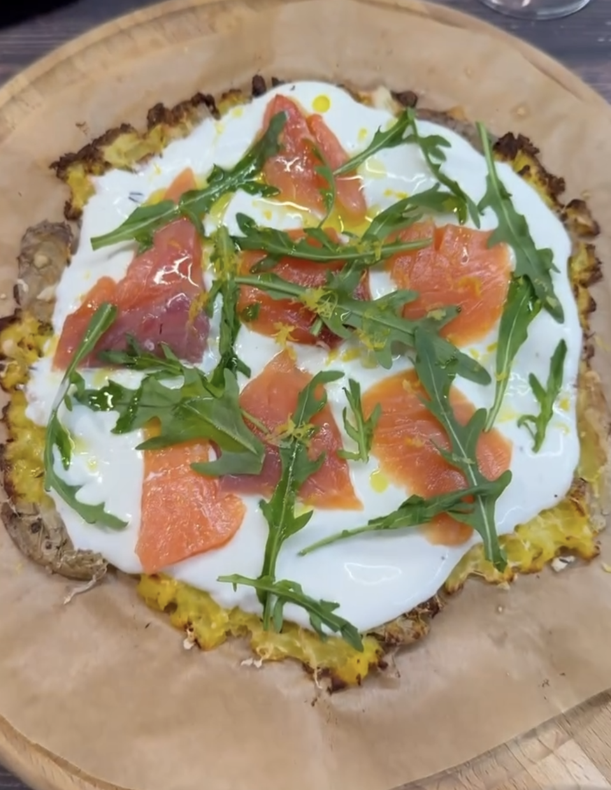

# Картофельная лепёшка с лососем

#### Ингредиенты
* картофель бэби 200 г
* пармезан 30 г
* тимьян 1 веточка
* греческий йогурт 150 г
* чеснок 1 маленький зубчик
* лимон 1 шт.
* красная рыба слабосолёная или холодного копчения
* руккола
* оливковое масло
* соль
* перец

#### Приготовление
Пармезан натереть. Чеснок раздавить. Красную рыбу нарезать кусочками.

Картофель в кожуре отварить в подсоленной воде до готовности.

Горячий картофель выложить на пергамент и раздавить обратной стороной стакана. Равномерно распределить (распределять тонко по центру, чтобы середина не осталась влажной), посолить, посыпать тёртым пармезаном и тимьяном.

Выпекать 30 минут при 180 °C (при необходимости выпекать дольше или при более высокой температуре).

Смешать греческий йогурт с раздавленным чесноком, посолить, поперчить и добавить лимонный сок по вкусу.

На горячую лепёшку распределить йогуртовый соус, выложить кусочки красной рыбы и рукколу. Сверху натереть цедру лимона и полить небольшим количеством оливкового масла.

*ig: foodedlife*