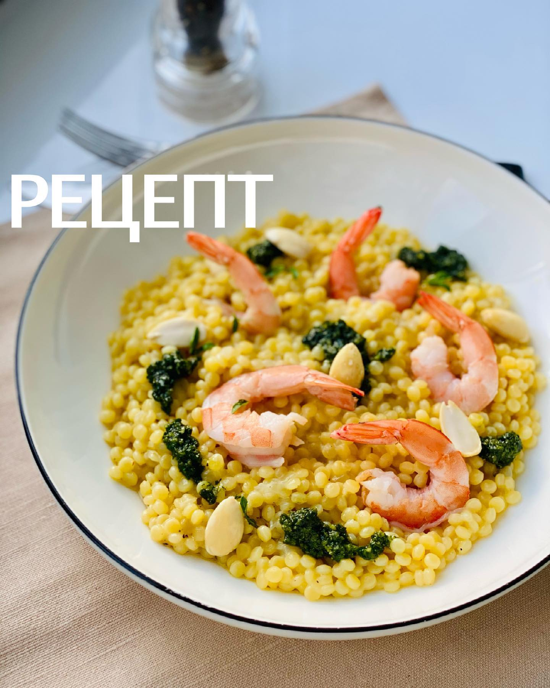

# Птитим с креветками, песто и миндалём

#### Ингредиенты
* креветки
* сливочное масло
* птитим
* пармезан
* зеленое песто
* очищенный миндаль

#### Приготовление

Пармезан натереть. Креветки очистить (если используются неочищенные).

Сырые креветки обжарить.

На сковороде разогреть сливочное масло. Добавить птитим и продолжать обжаривать, пока он не пропитается маслом. Влить кипяток так, чтобы он покрыл птитим, и посолить. Варить на медленном огне до готовности, периодически помешивая и добавляя воду.

В конце добавить тёртый пармезан и хорошо перемешать.

Подавать птитим с креветками, песто и очищенным миндалём.

*ig: @foodedlife*
