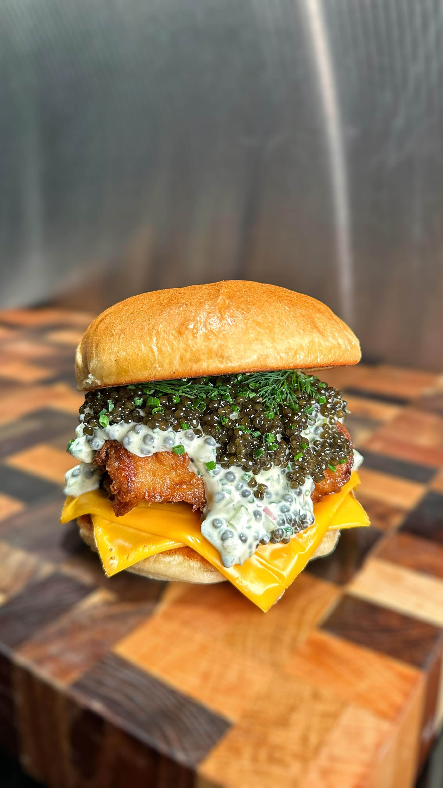

# Филе-о-Фиш с икрой

#### Ингредиенты

на 4 бургера

**для рыбы и панировки:**
* филе спинки трески или пикши
* морская соль
* лимонная цедра
* приправленная пшеничная мука
* арахисовое масло (для фритюра)

**для кляра по методу Хестона:**
* пшеничная мука 200 г
* рисовая мука 200 г
* разрыхлитель 1 ч. л.
* мёд 1 ст. л.
* холодное пиво 300 мл
* холодная водка 200 мл
* чесночный порошок
* кайенский перец
* соль и перец
* яйцо 1 шт.

**для соуса тартар с икрой:**
* крем-фреш 100 мл
* сметана 100 мл
* майонез Kewpie 100 мл
* корнишоны
* свежий укроп 1 пучок
* шнитт-лук
* лимонная цедра
* сок юдзу
* морская соль
* чёрный перец
* дижонская горчица 1 ст. л.
* мелкая икра 25 г

**для сборки:**
* булочки бриошь
* сливочное масло
* американский сыр (по 1–2 ломтика на бургер)
* икра (дополнительно, по желанию)
* шнитт-лук
* укроп

#### Приготовление
Филе спинки трески или пикши нарезать порционными кусками по размеру булочек. Приправить морской солью и лимонной цедрой, затем убрать в холодильник просолиться примерно на 1 час.

Корнишоны мелко нарезать кубиками. Укроп и шнитт-лук измельчить.

В глубокой кастрюле разогреть арахисовое масло примерно до 190–205 °C.

Достать рыбу из холодильника, обсушить и обвалять в приправленной пшеничной муке.

Для кляра соединить муку, разрыхлитель, мёд, холодное пиво и холодную водку. Добавить чесночный порошок, кайенский перец, соль, перец и яйцо (по желанию). Аккуратно перемешать, чтобы сохранить пузырьки воздуха.

Окунуть рыбу в кляр, осторожно опустить в разогретое масло по одному куску за раз и обжаривать до золотистого цвета. Для получения дополнительных хрустящих крошек полить рыбу во время жарки примерно 1 ст. л. кляра, чтобы он схватился и стал хрустящим.

Когда рыба станет золотистой и хрустящей (примерно через 4–5 минут), достать её и выложить на решётку отдохнуть, пока готовится соус.

Для соуса тартар смешать в миске крем-фреш, сметану, майонез Kewpie, нарезанные корнишоны, измельчённые пучок укропа и шнитт-лук, лимонную цедру, немного сока юдзу, морскую соль, чёрный перец и горчицу. Добавить икру, перемешать и отложить.

Булочки бриошь обжарить на сливочном масле.

Собрать бургеры: на нижнюю половину обжаренной булочки выложить 1–2 ломтика сыра и слегка расплавить кулинарной горелкой. Сверху положить хрустящее рыбное филе, соус тартар с икрой, добавить ещё икры по желанию, посыпать измельчённым шнитт-луком и укропом и накрыть верхней булочкой.

*ig: notorious_foodie*