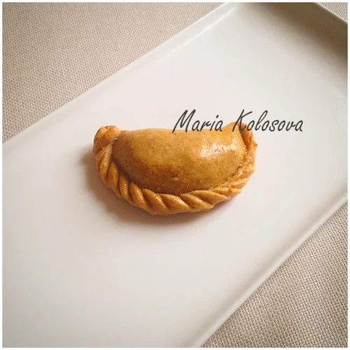

# Empanadas

Эмпанадас - блюдо, популярное в Латинской Америке и Испании. Начинки бывают совершенно разные.

### Empanadas de carne - Пирожки с мясом

#### Ингредиенты

на 8 штук: 85 г тесто, 65 г начинка

**для теста:**

* кукурузная мука (не полента) или пшеничная хлебная 400 г
* оливковое масло 140 г
* белое вино 80 г
* 1 яйцо
* соль 1 ч. л.
* яйцо для смазывания

**для начинки:**

* говяжий фарш 400 г
* томаты консерва или пассата 200 г
* сухой чеснок 1 ч. л.
* изюм 30 г
* зеленые оливки 90 г
* паприка, кумин, орегано, сахар по 1 ч. л.
* соль, черный перец
* оливковое масло
* 1 яичный желток

#### Приготовление

Для теста в миске смешать муку с солью. Сделать колодец. Влить масло, вино и яйцо. Замесить гладкое, эластичное тесто. Месить 5-7 минут. Оно не должно липнуть к рукам, будет приятным, маслянистым. Завернуть в плёнку и дать отдохнуть в холодильнике 30 минут (клейковина расслабится).

Оливки мелко нарезать. Изюм замочить в тёплой воде. На масле обжарить фарш, добавить остальные ингредиенты, потушить пару минут.

Тесто поделить и округлить. Раскатать тонко (3-4 мм). В центр каждого выложить столовую ложку начинки с горкой. Края смочить водой.

Защип. Сложить кружок пополам (полумесяц). Пройтись пальцами, выгоняя воздух, затем прижать вилкой, создавая ребристый шов или защипить «как вареник». Сверху сделать 2-3 прокола вилкой для выхода пара.

Выпечка. Выложить эмпанады на противень с пекарской бумагой. Смазать яйцом. Выпекать с конвекцией при 180°C до интенсивного золотого цвета (примерно 15-20 минут).

### Эмпанадас с яйцами, ветчиной, оливками и чеддером

#### Ингредиенты

**для начинки:**

* оливки 40 г
* ветчина 95 г
* сыр чеддер 30 г
* 2 яйца

#### Приготовление

Сварить яйца 10 минут, охладить 5 минут в холодной воде, очистить и мелко нарезать.
Смешать яйца, нарезанные оливки, нарезанную ветчину и тертый чеддер.

### Эмпанадас с грибами и горгонзоллой

* горгонзолла
* грибы
* тимьян
* яичный желток
