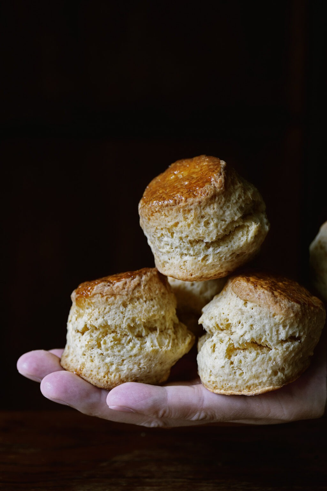

# Идеальные английские сконы к чаю \| Perfect English Tea Scone

#### Ингредиенты

на 14 шт.

* 2 куриных яйца крупных
* натуральный йогурт 90 г
* жирные сливки 90 мл
* пшеничная мука 480 г
* разрыхлитель 10 г
* пищевая сода 3 г
* светло-коричневый сахар 80 г
* мелкая морская соль 6 г
* несолёное сливочное масло 140 г

#### Приготовление

Масло нарезать кубиками.

Яйцо разбить в чашку и взбить до однородности. Отделить 1 ст. л. взбитого яйца в отдельную емкость для смазывания (воду не добавлять). К оставшемуся яйцу добавить йогурт и жирные сливки, взбить венчиком до однородности.

В большой миске смешать венчиком муку, разрыхлитель, соду, коричневый сахар и мелкую морскую соль. Добавить сливочное масло и перетереть его руками с мукой до состояния мелкой крошки (крупных кусочков масла оставаться не должно).

Влить жидкие ингредиенты в сухую смесь. Перемешать лопаткой, пока не останется сухой муки, затем быстро замесить тесто руками, собирая его в шар.

Переложить тесто на рабочий стол без подпыления мукой. Вымесить тесто ещё несколько раз до появления легкого сопротивления при нажатии (тесто должно стать однородным, но не таким гладким, как дрожжевое).

Слегка подпылить тесто мукой и раскатать в пласт толщиной 3 см. Выровнять поверхность плоской стороной скребка.

Вырезать сконы круглой формой диаметром 5 см, строго нажимая вниз без поворота формы. Переложить заготовки на противень, застеленный пергаментом.

Смазать верх сконов отложенным яйцом. Оставить противень в холодильнике на 30–40 минут не накрывая.

Разогреть духовку до 210 °C.

Перед выпечкой нанести второй слой яйца поверх подсохшего первого слоя.

Выпекать на среднем уровни духовки 10 минут, затем выключить духовку и оставить сконы внутри ещё на 5 минут.

Переложить на решётку. Подавать тёплыми с топлёными сливками (clotted cream) и джемом.

*ladyandpups.com*