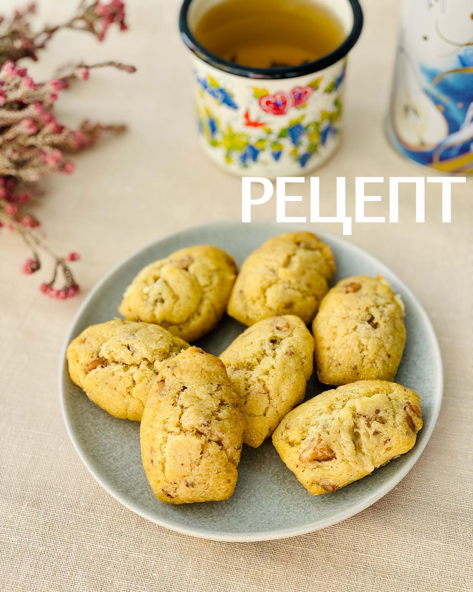

# Мадлен с грецким орехом и сыром с голубой плесенью

#### Ингредиенты

на 24 штуки

* мука 150 г
* разрыхлитель 10 г
* сливочное масло 60 г
* яйца 220 г (4–5 шт.)
* рокфор или другой голубой сыр 75 г
* грецкие орехи 75 г
* оливковое масло 80 г
* соль 2 щепотки
* перец 2 щепотки

#### Приготовление

Сыр и орехи мелко порубить. Масло сливочное растопить.  
Смешать яйца с сыром. Добавить муку с разрыхлителем, перемешать. Добавить сливочное масло, оливковое масло, соль, перец, орехи и хорошо перемешать.  
Отсадить тесто в формы при помощи кондитерского мешка.  
Поставить в нагретую до 210С духовку. Выключить. Через 4 минуты включить на 120С и выпекать 12 минут. Форму лучше ставить чуть выше среднего уровня в духовке.

_ig: foodedlife_
