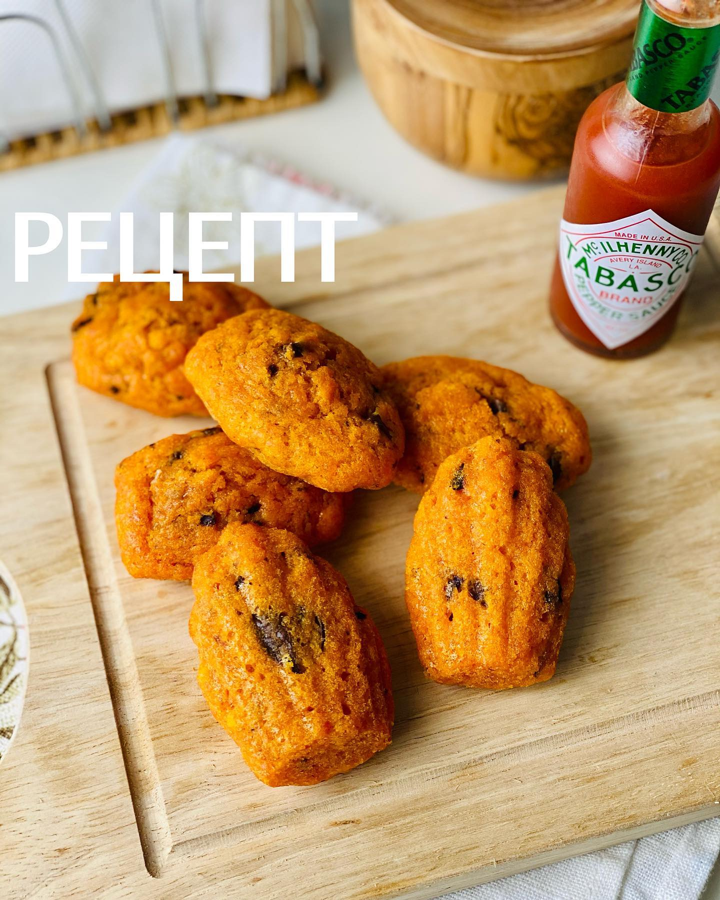

# Томатные мадлен с оливками и табаско

#### Ингредиенты
на 18 штук

* мука 150 г
* разрыхлитель 10 г
* сливочное масло 60 г
* яйца 220 г (4–5 шт.)
* томатная паста 60 г
* сыр 75 г
* оливки 75 г
* табаско 3 г
* оливковое масло 80 г
* соль 2 щепотки
* перец 2 щепотки

#### Приготовление
Оливки мелко нарезать. Сыр натереть. Сливочное масло растопить.

Муку смешать с разрыхлителем. Добавить растопленное сливочное масло, яйца, томатную пасту, натёртый сыр, нарезанные оливки, табаско, соль, перец и оливковое масло. Хорошо перемешать.

Духовку нагреть до 210 °C. Отсадить кондитерским мешком тесто в формы для мадлен.

Поставить форму в духовку, выключить духовку на 4 минуты, затем включить на 120 °C и выпекать 12 минут.

_ig: christophemichalak_
