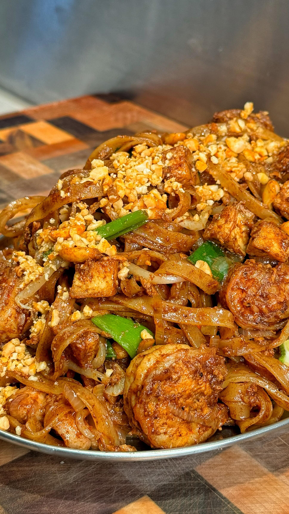

# Пад Тай \| Pad Thai

#### Ингредиенты
на 2 порции

**для белковой основы:**
* куриное бедро без кости и кожи 1 шт.
* королевские креветки 8 шт.
* твёрдый тофу 1 блок ~ 400 г

**для соуса:**
* паста тамаринда 2 ст. л.
* тёмный соевый соус 1 ст. л.
* пальмовый сахар или обычный сахарный песок 1,5 ст. л.
* устричный соус 1 ст. л.
* рыбный соус 1 ст. л.

**для ароматной основы:**
* чеснок 2 зубчика
* сладкий маринованный редис 1 ст. л.
* мелкие сушёные креветки нечищенные 1 ст. л.
* красный перец чили 1 шт.

**для лапши и подачи:**
* плоская сушеная рисовая лапша 150 г
* яйца 2 шт.
* зелёный лук 2 стебля
* ростки фасоли 1 горсть
* жареный арахис 1 горсть
* лайм 1 шт.

**дополнительно:**
* нейтральное растительное масло
* морская соль
* чёрный перец
* белый перец

#### Приготовление
У королевских креветок удалить головы, хвосты и панцирь (если они не очищены заранее). Сделать неглубокий надрез вдоль спинки и удалить кишечную вену. Слегка промыть креветки под холодной водой, полностью обсушить и отложить.

Курицу нарезать кусочками на один укус, сохраняя небольшую неоднородность формы, и отложить. Твёрдый тофу нарезать кубиками среднего размера (не слишком мелко, чтобы кусочки не развалились в воке).

Сухую плоскую рисовую лапшу замочить в воде комнатной температуры на 20–30 минут, пока она не станет гибкой, но останется слегка упругой и аль денте (не использовать горячую воду или кипяток). Слить воду и отложить лапшу.

Красный перец чили тонко нарезать. Чеснок и маринованный редис измельчить. Отмерить сушёные креветки. Зелёный лук нарезать, жареный арахис измельчить, лайм нарезать дольками.

Для соуса пальмовый сахар мелко нарубить или натереть. Соединить в миске пасту тамаринда, тёмный соевый соус, рыбный соус, устричный соус и пальмовый сахар, хорошо перемешать.

Разогреть вок на средне-сильном огне. Когда вок хорошо прогреется, влить немного нейтрального растительного масла.

Выложить креветки по одной за раз для максимального контакта с поверхностью вока и приправить морской солью. Обжаривать 1 минуту, затем перевернуть и через 30 секунд снять со сковороды.

Выложить в вок тофу, приправить солью и чёрным перцем. Обжаривать до золотистой корочки с нескольких сторон, не перемешивая слишком активно в начале, чтобы образовалась корочка. Снять и отложить.

Выложить в вок курицу, приправить солью и белым перцем. Перевернуть примерно через 1 минуту и обжарить с другой стороны до золотистой корочки с карамелизированными краями. Снять и отложить.

В тот же вок при необходимости добавить немного масла, затем выложить нарезанный чеснок, маринованный редис, сушёные креветки и красный перец чили. Сбрызнуть небольшим количеством нейтрального масла.

Быстро обжарить, помешивая, до появления яркого аромата и лёгкого подрумянивания, не допуская подгорания. Через несколько минут влить смесь для соуса и перемешать, соскребая прижарки со дна вока.

Убавить огонь до среднего и уваривать соус несколько минут до растворения сахара и получения глянцевой густой консистенции.

Вернуть средне-сильный огонь и выложить замоченную лапшу прямо в вок. Непрерывно перемешивать, чтобы лапша равномерно впитала соус. Если сковорода кажется сухой, добавлять понемногу воду, чтобы лапша дошла до готовности, не прилипая и не ломаясь.

Когда лапша полностью покроется соусом, добавить зелёный лук, ростки фасоли, измельчённый арахис и обжаренные курицу, креветки и тофу. Аккуратно перемешать методом складывания, чтобы не поломать лапшу, до равномерного распределения ингредиентов.

Сдвинуть всё содержимое к одной стенке вока, добавить немного масла, разбить 2 целых яйца и слегка перемешать их на горячем дне вока до схватывания.

Слегка перемешать всё вместе, попробовать и при необходимости скорректировать вкус (добавить немного рыбного соуса для солёности или сока лайма для кислинки).

Сразу выложить на тарелки в горячем виде и подавать, посыпав дополнительным измельчённым арахисом и полив соком лайма.

*Notorious Foodie*
