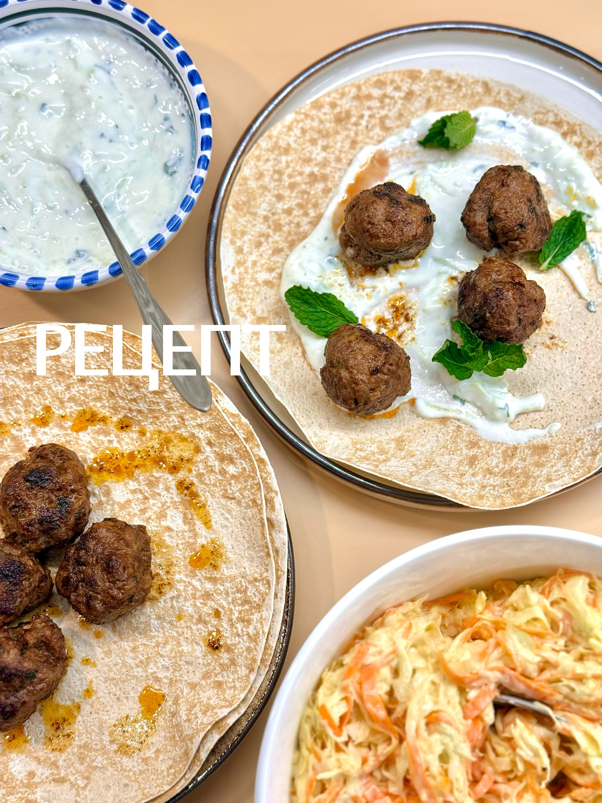

# Кюфта из ягнёнка с дзаздики

#### Ингредиенты

4 порции

**для кюфты:**
* фарш из ягнёнка 500 г
* репчатый лук 1 шт.
* мята 2–3 веточки
* чеснок 1 зубчик
* кинза 2 пучка
* яичный желток 1 шт.
* паприка 1 ст. л.
* кумин 1 ч. л.

#### Приготовление

Чеснок, мяту и кинзу мелко порубить. 

Соединить фарш из ягнёнка, порубленные лук, чеснок и зелень. Добавить яичный желток, паприку, кумин, соль и черный перец. Тщательно перемешать. Сформировать шарики весом около 25 г.

Обжарить кюфту на растительном масле в сковороде.

Подавать кюфту с дзаздики и питой или лавашом.

*ig: foodedlife*