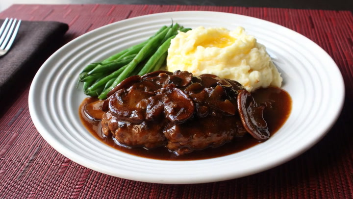

# Солсбери стейк \| Salisbury Steak

#### Ингредиенты

4 порции

**для котлет:**
* говяжий фарш (85% нежирности) 455 г
* панировочные сухари 60 г
* куриное яйцо 1 крупное
* кетчуп 30 мл
* вустерский соус 1 ст. л.
* сухая горчица 1 ч. л.
* соевый соус 1 ч. л.
* кайенский перец 1 щепотка
* сливочное масло 30 г
* соль, свежемолотый черный перец по вкусу

**для соуса:**
* сливочное масло 30 г
* крупные шампиньоны 12 шт.
* соль по вкусу
* пшеничная мука 2 ст. л.
* говяжий бульон (с низким содержанием соли) 720 мл
* кетчуп 30 мл
* вустерский соус 1 ст. л.

#### Приготовление

В миске смешать фарш, панировочные сухари, взбитое яйцо, кетчуп, вустерский соус, сухую горчицу, соевый соус, черный перец и кайенский перец до однородности. Накрыть пленкой и убрать в холодильник минимум на 2 часа (или на ночь).

Шампиньоны нарезать слайсами. В большой сковороде с антипригарным покрытием растопить 30 г сливочного масла на сильном огне. Добавить шампиньоны, посолить, обжарить до золотистой корочки 5–8 минут. Уменьшить огонь до среднего, всыпать муку и готовить, помешивая, 3 минуты.

Влить говяжий бульон, кетчуп и вустерский соус. Довести до кипения на сильном огне, затем уменьшить огонь до среднего и тушить, изредка помешивая, около 10 минут до легкого загустения соуса. Посолить по вкусу и перелить соус в отдельную емкость.

Извлечь мясную смесь из холодильника и разделить на 4 равные части. Влажными руками сформовать из каждой порции овальную котлету толщиной 1,25 см. Слегка посолить котлеты с обеих сторон.

В чистой сковороде растопить 30 г сливочного масла на средне-сильном огне. Выложить котлеты и обжаривать по 2–3 минуты с каждой стороны до румяной корочки.

Залить котлеты соусом и довести до кипения. Уменьшить огонь до среднего и тушить еще около 5 минут, пока соус не станет очень горячим, а котлеты полностью не пропекутся внутри (температура внутри должна достигнуть не менее 70 °C).

Подавать с картофельным пюре со сливочным маслом и овощным гарниром на выбор.

*John Mitzewich aka Chef John*
