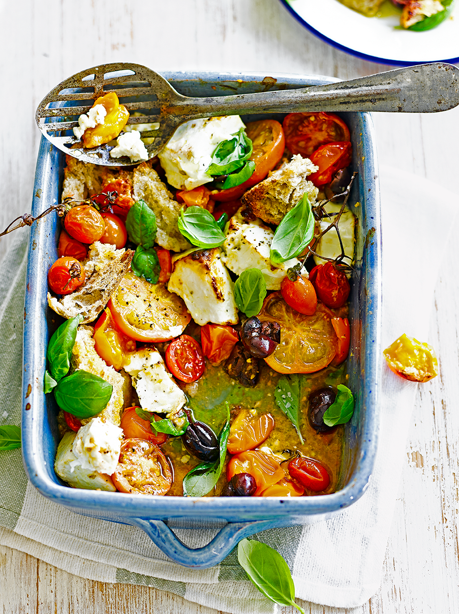

# Запеченная фета с томатами \| Baked Feta & Tomatoes

#### Ингредиенты

4 порции

* сыр фета 250 г
* смесь томатов 500 г
* оливки каламата с косточкой 1 горсть
* хлеб на закваске 200 г
* свежий базилик 0,5 пучка
* оливковое масло
* соль
* черный перец

#### Приготовление

Разогреть духовку до 180 °C.

Покрошить сыр фета крупными кусочками. Крупные томаты крупно нарезать, а мелкие оставить целыми. Удалить косточки из оливок. Порвать хлеб на закваске на кусочки. Оборвать листья базилика.

Соединить в противне сыр фета, томаты, оливки, хлеб на закваске и немного оливкового масла. Посолить и поперчить.

Запекать в духовке 30 минут, пока томаты не станут мягкими, а фета не подрумянится по краям.

Посыпать базиликом и подавать.

*Jamie Oliver*