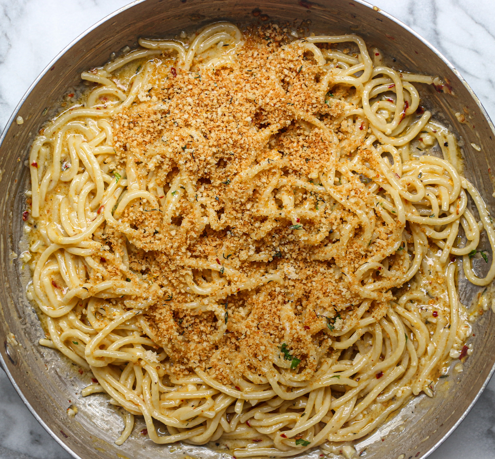

# Сливочная лимонная паста с хрустящими крошками и артишоком

#### Ингредиенты

* Сухари панко 40 г
* Чесночный порошок
* Молотая паприка 1 ч л
* Свежий тимьян 1 ст л
* Сливочное масло 50 г
* Спагетти 150 г
* Сок и цедра 1 среднего лимона
* Пармезан 30 г
* Соль и черный перец по вкусу
* Консервированный артишок

#### Приготовление

Натереть пармезан на самой мелкой терке до состояния порошка, чтобы он мгновенно растворился в соусе, не образуя комочков и не становясь зернистым. 

Приготовить хрустящие хлебные крошки, разогреть 10 г сливочного масла на среднем огне, добавить панировочные сухари, чеснок, паприку, тимьян, обжарить, часто помешивая, пока крошки не станут золотистыми.

Отварить пасту al dente. 

Натереть цедру 1 лимона, затем разрезать его пополам, выжать сок. Добавить 1 половник воды от варки пасты в сковороду на средний огонь, добавить туда же лимонный сок. Отваренную пасту выложить в сковороду, туда же добавить половинки лимона. Уменьшить огонь до слабого и добавить сливочное масло постепенно, энергично помешивая и встряхивая сковороду. Энергично перемешивать, добавляя понемногу пармезан и, при необходимости, воду, в которой варилась паста, чтобы соус оставался чистым, кремообразным и блестящим, не становясь сухим. В конце удалить половинки лимона, добавить лимонную цедру и перемешать. 

Подавать, посыпав хрустящими панировочными сухарями, украсив артишоком.
