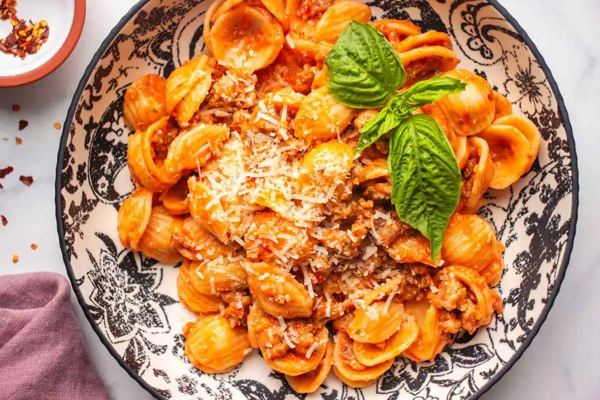

# Ореккьетте по-позитански \| Orecchiette alla positanese

#### Ингредиенты
* ореккьетте 160 г
* помидоры черри 200 г
* колбаски мелкого помола 100 г
* буррата 1 шт.
* чеснок ½ головки
* мелкая соль по вкусу
* оливковое масло extra virgin по вкусу
* свежий базилик по вкусу
* пармезан по вкусу

#### Приготовление
С колбасок снять оболочку и измельчить. В сковороду налить оливковое масло и выложить колбаски. Обжаривать на сильном огне около 6 минут до золотистой и хрустящей корочки.

Помидоры черри вымыть. В форму для запекания выложить помидоры черри вместе с половиной цельной головки чеснока с шелухой, полить оливковым маслом и посыпать мелкой солью. Запекать в духовке с конвекцией при 220 °C около 15 минут до золотистой корочки снаружи.

В чашу блендера переложить запечённые помидоры и свежую буррату. Приправить солью и перцем, взбивать на максимальной мощности не менее 2 минут.

Ореккьетте опустить в большое количество кипящей слегка подсоленной воды. Отварить, слить воду и смешать пасту с приготовленным соусом.

Выложить на тарелки, полить оливковым маслом, добавить обжаренные колбаски, посыпать тёртым пармезаном (по желанию) и свежим базиликом.

*Tiktok: chef.antonio.la.cava*
