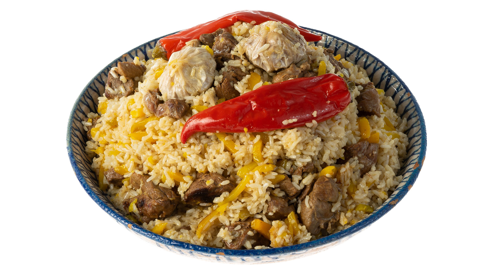

# Плов узбекский

#### Ингредиенты

6 порций

* рис (девзира или басмати) 500 г
* баранина (мякоть вырезки или задка) или бараньи ребрышки 500 г
* курдюк 100 г
* растительное масло (подсолнечное, кукурузное или рапсовое) 100 г (или 200 г при отсутствии курдюка)
* кунжутное масло (не более 1/6 части от объема растительного масла)
* репчатый лук 1 шт.
* морковь (желтая или рыжая) 500 г
* чеснок 1 головка
* соль 0,5 ст. л.
* зира 0,5 ч.л.
* кориандр молотый 0,5 ч.л.
* черный перец молотый 0,5 ч.л.
* барбарис 0,5 ч.л.
* вода (кипяток) 250 мл
* зелень (кинза или петрушка)
* свежая айва (опционально)
* нут (опционально)
* изюм (опционально)
* сухая алыча (опционально)
* курага (опционально)
* соленые огурцы (опционально)
* перепелиные яйца (опционально)

#### Приготовление

Рис басмати или девзира промыть в течение 15 минут до прозрачности. Барбарис замочить в кипятке.

Баранину зачистить от жилок и нарезать кусочками размером 3 см. Бараньи ребрышки разделить на сегменты и нарубить на кусочки размером в половину пальца. Курдюк нарезать маленькими кусочками. Морковь нарезать длинной соломкой вручную. С головок чеснока счистить верхнюю жесткую шелуху, не разделяя на зубчики. Айву нарезать на половинки. Перепелиные яйца отварить и очистить.

В казане вытопить курдюк до шкварок, затем убрать шкварки. Влить растительное масло (с добавлением кунжутного масла) и разогреть казан до появления легкого дыма.

В раскаленное масло опустить 1 целую луковицу. После ее почернения вынуть и выбросить. Выложить бараньи ребрышки и обжаривать на максимальном огне 5–10 минут до румяной корочки, затем переложить на тарелку.

Выложить в казан морковь и жарить на максимальном огне, постоянно помешивая, 15 минут до мягкости моркови. Достать овощи шумовкой.

Выложить в казан мякоть баранины и обжаривать во фритюре на максимальном огне 5 минут до румяной корочки, периодически переворачивая. Посолить 1 ст. л. соли, посыпать зирой, кориандром и черным перцем.

Вернуть в казан ребрышки, лук, морковь, добавить головку чеснока, барбарис, нут, айву, сухофрукты или соленья. Залить водой так, чтобы она возвышалась над ингредиентами на 1 см. Варить зирвак 40–60 минут.

Вынуть из готового зирвака чеснок и айву. Выложить рис в казан поверх зирвака, разровнять поверхность и влить 250 мл (стакан) кипятка. Варить на сильном огне, не перемешивая и не закрывая крышкой, пока рис не впитает воду и не станет мягким (при необходимости доливать кипяток).

Убавить огонь до минимума, собрать рис горкой и сделать в нем несколько проколов скалкой или ручкой половника. Вложить в проколы чеснок и айву. Плотно закрыть казан крышкой и оставить пропариваться на 20–30 минут.

Готовый плов аккуратно перемешать. Выложить рис на блюдо, сверху выложить мясо, морковь, чеснок, айву и отваренные перепелиные яйца. Посыпать зеленью кинзы или петрушки. Подавать с салатом.

*Кахабер Козаев, шеф-повар ресторана «Ткемали»*