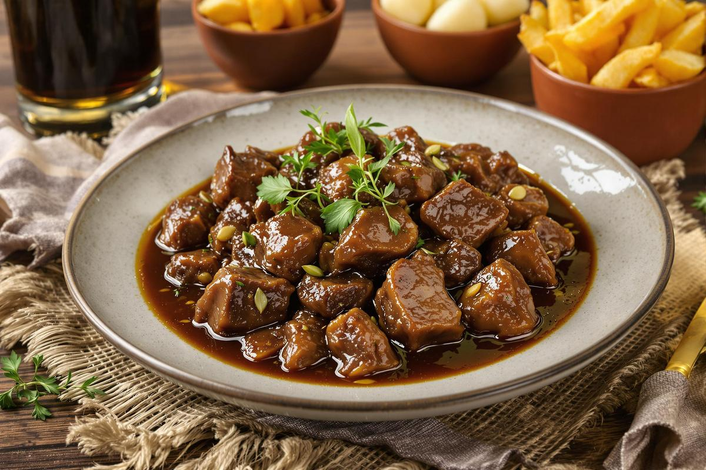

# Карбонад по-фламандски \| Carbonade flamande

#### Ингредиенты

4 порции

* говядина для тушения без костей 1 кг
* сливочное масло 2 ст. л.
* морковь 1 шт.
* репчатый лук 2 шт.
* сливочное масло 30 г
* пшеничная мука 1 ст. л.
* коричневый сахар 1 ст. л.
* тёмное пиво (Trappiste Rochefort или Chimay bleue) 750 мл
* pain d'épices 100 г
* горчица по вкусу
* лавровый лист 1 шт.
* свежая петрушка по вкусу
* соль по вкусу
* черный перец по вкусу

#### Приготовление

Разогреть духовку до 240 °C.

В большой кастрюле разогреть сливочное масло. Выложить кусочки говядины (без специй) и сильно обжарить со всех сторон до образования выраженной румяной корочки.

Добавить морковь, репчатый лук и сливочное масло, пассеровать несколько минут. Смешать мясо с пшеничной мукой и обжарить.

Перемешать мясо, добавить коричневый сахар, влить тёмное пиво и дать соусу слегка увариться в течение нескольких минут. Добавить лавровый лист, посолить и поперчить по вкусу.

Ломтики pain d'épices щедро смазать горчицей и выложить поверх мяса в кастрюлю, не перемешивая.

Накрыть кастрюлю крышкой и запекать при температуре 100–120 °C в течение 30 минут. Перемешать блюдо до полного растворения pain d'épices в соусе.

Накрыть крышкой и продолжать тушить при температуре 100 °C не менее 4 часов.

Проверить и при необходимости скорректировать количество соли и перца.

Свежую петрушку мелко нарезать. Перед подачей посыпать карбонад измельчённой петрушкой. Подавать с картофелем фри.