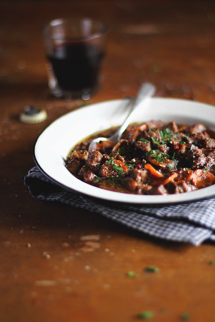

# Ирландское рагу с пивом \| Stobhach gaelach

#### Ингредиенты

6 порций

* бараньи ребрышки на косточке 900 г
* растительное масло 3 ст. л.
* пшеничная мука 2 ст. л.
* соль 1 ч. л.
* черный перец 1 ч. л.
* кайенский перец 1 ч. л.
* репчатый лук 2 шт.
* чеснок 1 зубчик
* томатная паста 2 ст. л.
* вода 4 ст. л.
* красный эль 800 мл или пиво Guinness напополам с водой
* морковь 180 мл
* тимьян 1 веточка
* петрушка по вкусу

#### Приготовление

Мясо перемешать в миске с 1 ст. л. растительного масла. Смешать пшеничную муку с солью, свежемолотым черным перцем и кайенским перцем. Обвалять мясо в этой смеси.

Разогреть оставшееся растительное масло в широкой сковороде на сильном огне. Обжарить мясо со всех сторон до румяной корочки. Томатную пасту растворить в 4 ст. л. воды. Добавить в сковороду лук, чеснок и растворенную томатную пасту, накрыть крышкой и готовить на медленном огне 5 минут.

Переложить содержимое сковороды в кастрюлю для запекания. Влить часть пива в сковороду, довести до кипения и перемешать, чтобы растворить пригар со дна.

Перелить жидкость из сковороды к мясу в кастрюлю и влить оставшееся пиво. Морковь нарезать крупными кусочками. Добавить в кастрюлю морковь и тимьян. Перемешать, попробовать и при необходимости добавить немного соли.

Накрыть кастрюлю крышкой и тушить на очень медленном огне 2–3 часа до мягкости мяса (на плите или в духовке, разогретой до 150 °C).

Попробовать и скорректировать количество специй. Мелко нарезать петрушку. Посыпать жаркое петрушкой и подавать.