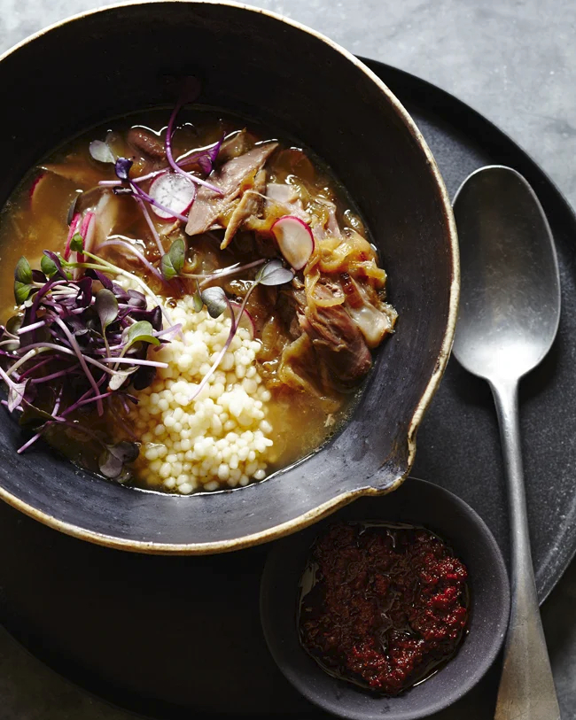

# Мавританский тажин с кускусом | Moorish Tagine with Couscous

#### Ингредиенты

**для тажина:**
* оливковое масло 60 мл
* баранья голяшка или курица кусками 1 кг
* солёный лимон 2 шт.
* репчатый лук 1 крупная шт.
* чеснок 4 зубчика
* молотый имбирь 2 ч. л.
* куркума 1 ч. л.
* рас-эль-ханут 1/2 ч. л.
* шафран 1 щепотка
* красное вино 480 мл
* зеленые оливки
* петрушка 1 небольшой пучок
* кинза 1 небольшой пучок
* морская соль хлопьями, свежемолотый черный перец по вкусу

**для подачи:**
* кускус
* редис
* ростки редиса

#### Приготовление

Мякоть солёного лимона отделить от цедры и мелко нарезать. Цедру лимона сохранить.Чеснок измельчить. Петрушку и кинзу связать в один пучок. Редис нарезать ломтиками.

Разогреть духовку до 150 °C.

В жаровне с толстым дном разогреть 2 ст. л. оливкового масла на среднем огне. Бараньи голяшки или курицу приправить солью и черным перцем, обжарить со всех сторон до румяной корочки примерно по 5 минут с каждой стороны. Извлечь из жаровни и отложить.

Влить в жаровню оставшиеся 2 ст. л. оливкового масла. Добавить измельчённую мякоть солёного лимона, чеснок, молотый имбирь, куркуму, рас-эль-ханут и шафран. Готовить около 3 минут, пока специи не станут ароматными.

Вернуть мясо в жаровню. Влить красное вино и добавить достаточное количество воды, чтобы полностью покрыть мясо. Посолить и поперчить по вкусу. Добавить связанный пучок зелени и луковицу. Накрыть жаровню крышкой и довести смесь до кипения.

Переставить накрытую жаровню в духовку. Запекать до мягкости мяса, пока оно не станет легко отделяться от костей. Через 1 час тушения добавить в жаровню сохранённую цедру лимона и оливки, тушить еще 15-20 минут.

Снять жаровню с огня. Извлечь кости, аккуратно отделив мясо, и вернуть мясо обратно в соус. Удалить пучок зелени. Попробовать и скорректировать количество соли и черного перца. Добавить нарезанную кинзу.

Подавать с подготовленным кускусом, нарезанным редисом, ростками редиса.

*[Kitchen Repertoire](https://kitchenrepertoire.com)*