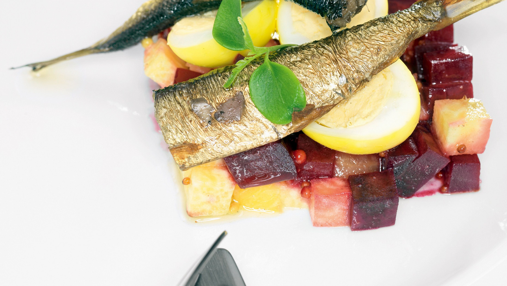

# Салат со шпротами, перепелиными яйцами и корнеплодами

#### Ингредиенты

* анис (бадьян) 2 шт.
* шпроты 100 г
* перепелиное яйцо 8 шт.
* свекла 2 шт.
* репа 2 шт.
* зеленый салат 20 г
* красный винный уксус 50 мл
* растительное масло 30 мл
* оливковое масло 30 мл
* зернистая горчица 1 ст. л.
* розмарин 10 г
* луковая шелуха 20 г

#### Приготовление

В кипящую воду добавить красный винный уксус, розмарин, бадьян и шелуху красного лука. Отварить перепелиные яйца в течение 5 минут. Вынуть яйца из отвара и очистить. Положить яйца обратно в остывающий отвар для маринования.

Разогреть духовку до 190 °C. Свеклу и репу сбрызнуть растительным маслом и завернуть в фольгу. Запекать корнеплоды в духовке 40 минут. Достать, остудить, очистить и нарезать небольшими кубиками.

Смешать зернистую горчицу с оливковым маслом и нарезанными овощами. Выложить овощную смесь на тарелку. Маринованные перепелиные яйца разрезать пополам. Выложить сверху половинки яиц, шпроты и зеленый салат (шпинат или кресс-салат).

_eda.ru_
