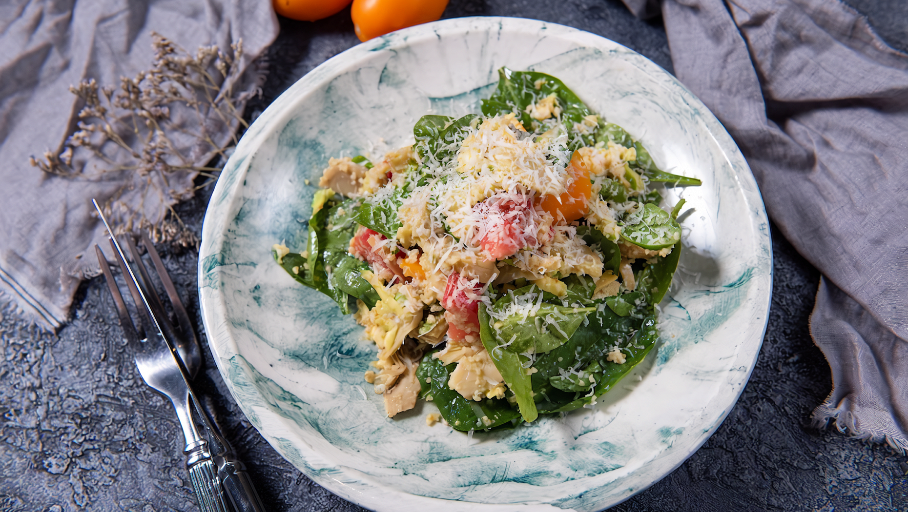

# Салат из булгура с авокадо

#### Ингредиенты

2 порции

* свежие листья шпината 100 г
* помидоры 160 г
* авокадо 100 г
* булгур 40 г
* сыр пармезан 20 г
* оливковое масло 60 мл
* лимонный сок 20 мл
* маринованные мини-артишоки 100 г

#### Приготовление

Булгур залить подсоленной кипящей водой в пропорции 1:2, плотно накрыть крышкой и дать пропариться 40 минут.

Половину мякоти авокадо натереть на крупной терке, другую половину нарезать крупными кубиками.

Помидоры нарезать ломтиками.

Шпинат положить в миску для подачи. Добавить наструганный хлопьями пармезан.

Смешать булгур, помидоры и тертую мякоть авокадо. Выложить смесь в миску поверх листьев шпината вместе с ломтиками авокадо.

Заправить салат оливковым маслом с соком лимона. Сверху посыпать салат тертым пармезаном и подавать.

*Виктор Белей, бренд-шеф ресторана Uhvat*
