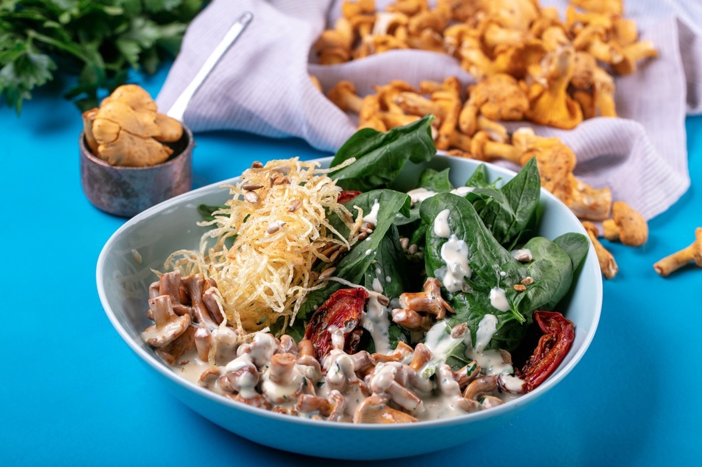

# Теплый салат с лисичками и голубым сыром

#### Ингредиенты

* лисички 210 г
* картофель 40 г
* масло для фритюра 150 мл
* сливочное масло 30 г
* сливки 33%-ные 50 мл
* сыр горгонзола 50 г
* соевый соус 10 мл
* руккола 30 г
* шпинат 30 г
* мангольд 30 г
* вяленые помидоры 50 г
* кедровые орехи 15 г
* бальзамический крем 10 г
* соль по вкусу

#### Приготовление

Лисички замочить в холодной воде на 5 минут, затем хорошо промыть.
Для картофеля пай картофель очистить и нарезать тонкой соломкой (можно воспользоваться корейской тёркой или мандолиной со специальной насадкой). Нарезанный картофель промыть под холодной водой и хорошенько обсушить на бумажном полотенце.

Отварить лисички в солёной воде 3–5 минут и откинуть на сито.

В сотейнике разогреть фритюрное масло. Опустить в масло деревянную шпажку (если на ней образуются пузырьки — можно жарить). Обжарить картофель до золотистого цвета и выложить на бумажное полотенце, чтобы убрать лишний жир.

Лисички припустить на сливочном масле, выпарить и обжарить до золотистого цвета. Посолить. К лисичкам влить и прогреть сливки. Добавить сыр горгонзола и тушить до образования однородной густой массы. Добавить соевый соус и перемешать.

В центр тарелки выложить вяленые помидоры и микс листьев салатов (руккола, шпинат, мангольд), сбрызнуть бальзамическим кремом. Вокруг выложить соус с лисичками.

Украсить салат картофелем пай и кедровыми орехами.

*Владимир Сидоров, шеф-повар ресторана «Черетто море»*