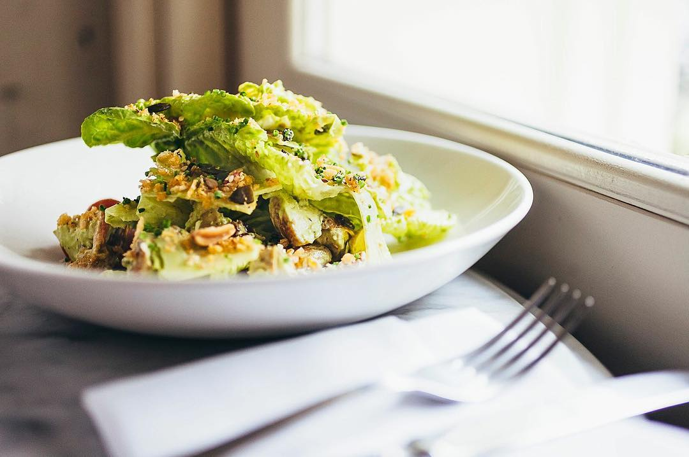

# Сытный салат с грудкой цыплёнка под соусом авокадо-ранч

#### Ингредиенты

* куриная грудка
* салат романо
* помидоры черри
* орехи
* сыр порволоне

**для соуса:**

* спелое авокадо
* греческий йогурт
* чесночный порошок
* лимонный сок 2 ст. л.
* яблочный уксус 1 ч. л.
* вода

#### Приготовление

Куриную грудку обжарить или запечь, охладить. Приготовить помидоры конфи с чесноком и травами.

Пробить все ингредиенты соуса в блендере, добавлять воду по 1 ст. л. до желаемой консистенции. Охладить 30 минут перед использованием.

На тарелки выложить половину салатных листьев, полить частью заправки, сверху выложить остальной салат и другие ингредиенты.