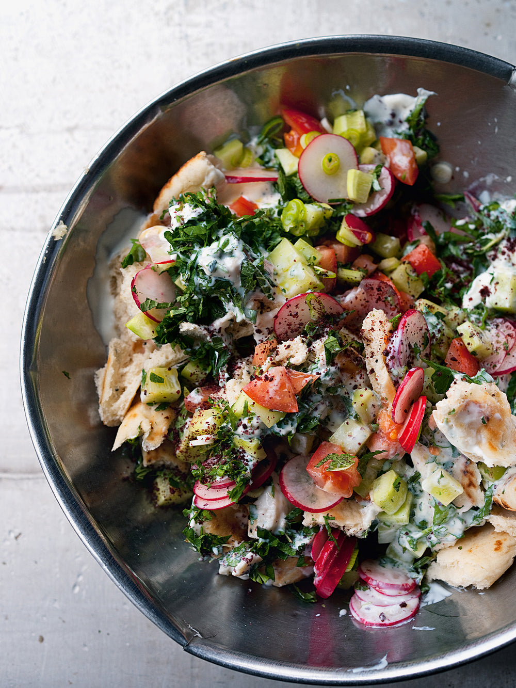

# Фаттуш \| Fattoush

Классический левантийский салат с хрустящими кусочками лепешки, свежими овощами, обильной зеленью и заправкой на основе домашней пахты, лимонного сока, оливкового масла и сумаха.

#### Ингредиенты

6 порций

* греческий йогурт 200 г и цельное молоко 200 мл
* черствый турецкий плоский хлеб или наан 2 шт.
* крупные помидоры 3 шт.
* редис 100 г
* ливанские или мини-огурцы 3 шт.
* свежая мята 15 г
* петрушка 25 г
* сушеная мята 1 ст. л.
* чеснок 2 зубчика
* лимонный сок 3 ст. л.
* оливковое масло 60 мл (плюс еще для подачи)
* яблочный или белый винный уксус 2 ст. л.
* крупномолотый черный перец, соль
* сумах 1 ст. л. (или по вкусу) для украшения

#### Приготовление

Нарезать помидоры и очищенные огурцы кубиками со стороной 1,5 см. Тонко нарезать редис и зеленый лук. Крупно порубить петрушку и свежую мяту. Чеснок пропустить через пресс или измельчить.

Если используются йогурт и молоко, за 3–24 часа до приготовления смешать их в миске, хорошо взбить венчиком и оставить в прохладном месте или в холодильнике до образования пузырьков на поверхности.

Порвать черствый хлеб на небольшие кусочки размером на один укус и переложить в большую миску.

Влить к хлебу забродившую йогуртовую смесь (или покупную пахту), затем добавить помидоры, огурцы, редис, зеленый лук, свежую и сушеную мяту, петрушку, чеснок, лимонный сок, оливковое масло, уксус, соль и черный перец. Тщательно перемешать и оставить на 10 минут, чтобы хлеб пропитался заправкой и раскрылись все вкусы.

Разложить салат фаттуш по салатникам, сбрызнуть оливковым маслом и щедро посыпать сумахом.

*Jerusalem Cookbook | Ottolenghi*
