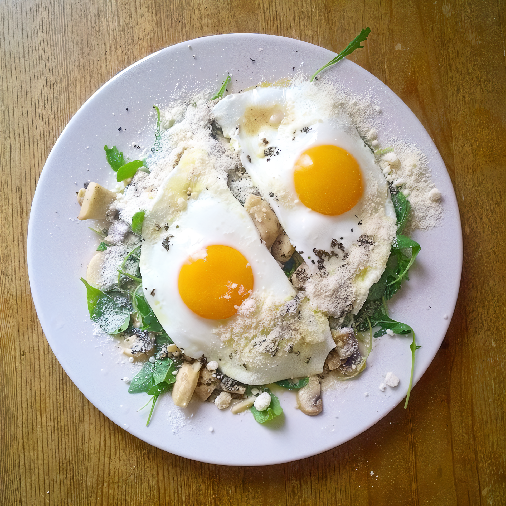

# Салат с жареными грибами и глазуньей

#### Ингредиенты

* шампиньоны 167 г
* куриное яйцо 2 шт.
* сыр пармезан 17 г
* рукола 67 г
* лимон ¼ шт.
* растительное масло 23 мл
* сливочное масло 10 г
* петрушка 7 г
* соль по вкусу
* молотый черный перец по вкусу

#### Приготовление

Шампиньоны нарезать тонкими ломтиками. Петрушку порубить. Сыр пармезан натереть.

Обжаривать шампиньоны на растительном масле, пока грибы не пустят сок. Посолить, поперчить, переложить в отдельную емкость и убрать в теплое место.

Жидкость из-под грибов заправить молотым перцем, соком ¼ лимона и рубленой петрушкой.

На сливочном масле поджарить глазунью из 6 яиц. Посолить, поперчить.

На тарелки выложить руколу, сверху — грибы и по фрагменту глазуньи (1 яйцо на порцию). Полить соусом из-под грибов, посыпать тертым пармезаном и подавать.

_eda.ru_
