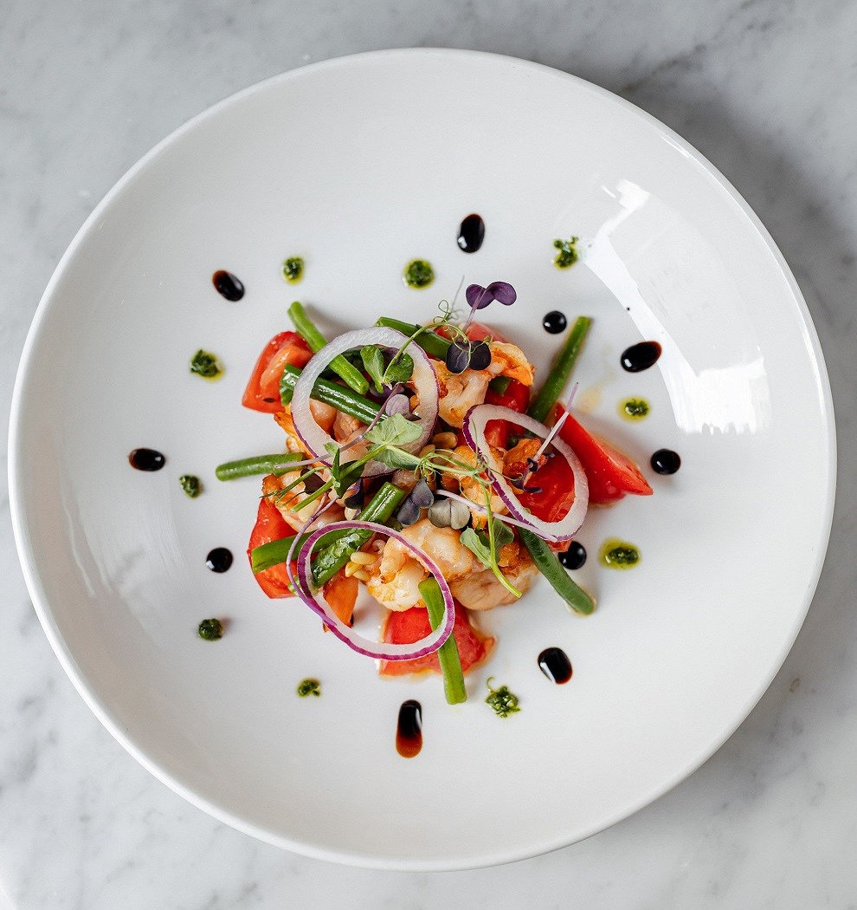

# Креветки с кенийской фасолью и томатами

#### Ингредиенты

2 порции

* очищенные крупные креветки 160 г
* зеленая фасоль 30 г
* бакинские помидоры 160 г
* кедровые орехи 8 г
* базилик 4 веточки
* оливковое масло 8 ст. л.
* лимонный сок 2 ст. л.
* бальзамический крем 20 г
* соус песто 20 г
* соль по вкусу

#### Приготовление

Забросить фасоль в кипящую подсоленную воду и варить 2 минуты. Затем сразу переложить фасоль в миску с ледяной водой, чтобы остановить готовку и сохранить яркий цвет.

Креветки обжарить на сковороде с добавлением масла до готовности, 5–6 минут.

Помидоры нарезать ломтиками, базилик мелко порубить.

Для заправки взбить оливковое масло с лимонным соком и солью.

В глубокой миске смешать обжаренные креветки, томаты, бланшированную фасоль, лук, базилик и кедровые орехи. Полить подготовленной оливково-лимонной заправкой и перемешать.

При подаче украсить тарелку каплями соуса песто и бальзамического крема.

*Лучано Касале, шефа ресторана Salumeria*