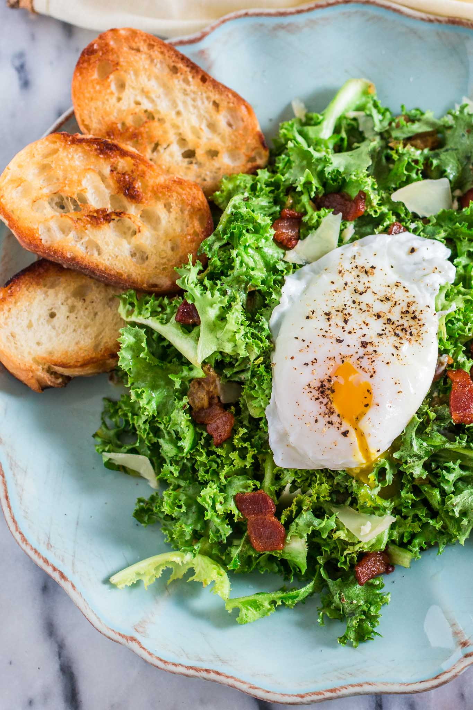

# Салат Лионнез \| Salade Lyonnaise

#### Ингредиенты

4 порции

* бекон толстой нарезки 5 ломтиков
* лимонный сок 1 ст. л.
* дижонская горчица 2 ч. л.
* оливковое масло 2 ст. л.
* салат фризе или эндивий 225 г
* хересный уксус 1 ст. л.
* яйца 4 шт.
* вода 240 мл
* соль, черный перец
* тертый грюйер

#### Приготовление

Нарезать бекон полосками шириной 1,5 см. Порвать салат фризе на небольшие кусочки.

В сковороду диаметром 30 см выложить бекон и влить 240 мл воды. Довести до кипения на среднем огне. Уменьшить огонь до средне-высокого и готовить 35–40 минут, пока вода не выпарится, а бекон не станет хрустящим. Шумовкой переложить бекон на бумажные полотенца.

Перелить 3 ст. л. беконного жира в большую миску. Добавить лимонный сок, дижонскую горчицу, измельченный лук-шалот, соль и черный перец. Взбивая венчиком, медленно влить оливковое масло до образования эмульсии. Добавить обжаренный бекон и салат фризе. Перемешать и разложить по тарелкам.

Приготовить яйца пашот и выложить по одному на каждую тарелку. Украсить свежемолотым черным перцем и тертым грюйером.
