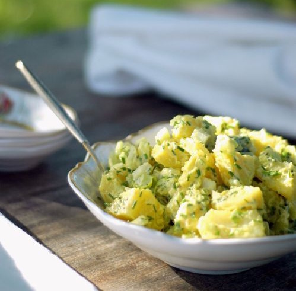

# Лимонный картофельный салат

#### Ингредиенты

* картофель
* лимонная цедра
* лимонный сок 2 ст.л.
* домашний майонез
* сметана
* черные оливки по вкусу
* соль
* перец

#### Приготовление

Отварить картофель, остудить, нарезать произвольными кубиками. Смешать все ингредиенты для заправки, добавить к картофелю и перемешать. Добавить оливки.
