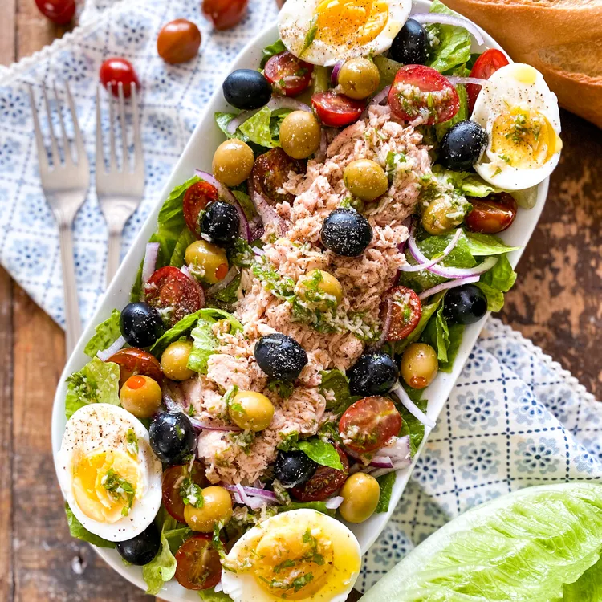

# Салат «Сан-Исидро» \| Ensalada de San Isidro

Традиционный салат из Мадрида, названный в честь святого покровителя города Сан-Исидро, день которого празднуется 15 мая.

#### Ингредиенты

**для заправки:**
* оливковое масло extra virgin 2 ст. л. (30 мл)
* хересный уксус 0,5 ст. л. (8 мл)
* чеснок 1 зубчик
* петрушка 4 г
* морская соль 1 щепотка
* черный перец 1 щепотка

**для салата:**
* салат ромэн 1 кочан
* помидоры черри 8 шт.
* тунец в оливковом масле 110 г
* зеленые оливки, фаршированные пименто 45 г
* черные оливки без косточек 45 г
* яйца 2 шт.

#### Приготовление

Сварить яйца вкрутую, остудить, очистить и нарезать вдоль пополам.

Мелко нарезать петрушку, измельчить чеснок.

Нарезать салат ромэн, разрезать помидоры черри пополам.

Откинуть тунец на сито и слить жидкость.

Для заправки смешать оливковое масло, хересный уксус, измельченный чеснок, петрушку, морскую соль и черный перец.

Выложить в салатник салат ромэн и помидоры черри. Сверху разложить тунец, зеленые и черные оливки, а также половинки яиц.

Посолить морской солью, поперчить и полить заправкой. Подавать сразу.

*Spain on a Fork*