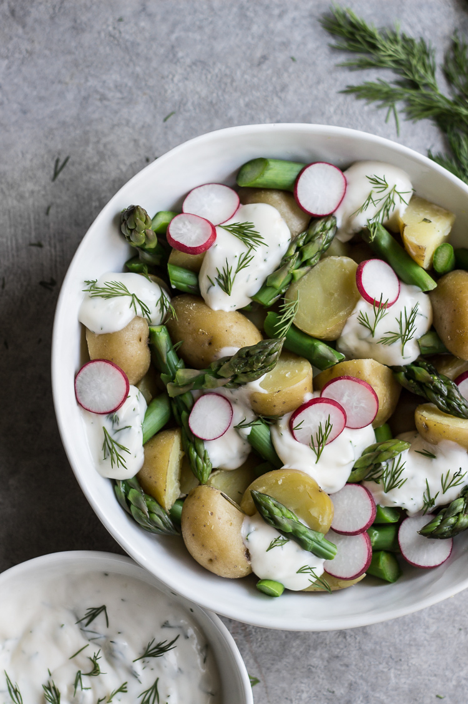

# Весенний картофельный салат

#### Ингредиенты

* картофель
* мята, розмарин, тимьян
* свежая спаржа
* пучок редиса
* лимонная цедра
* лимонный сок 2 ст.л.
* домашний майонез
* укроп
* соль, перец

#### Приготовление

Отварить картофель с мятой, розмарином и тимьяном, остудить, нарезать произвольными кубиками. Бланшировать спаржу и остудить в ледяной ванне.

Смешать все ингредиенты для заправки, добавить к картофелю, добавить нарезанные редис и спаржу и перемешать.
