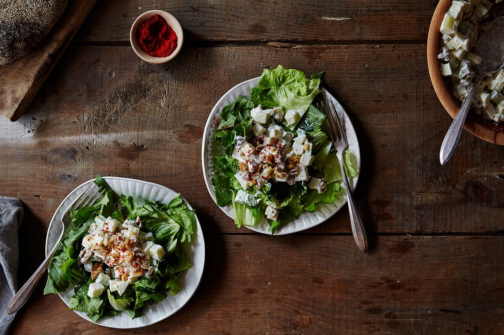

# Классический Уолдорфский салат \| Classic Waldorf Salad

Знаменитый салат, созданный в отеле «Уолдорф-Астория» в Нью-Йорке.

#### Ингредиенты

4 порции

* яблоки 240 мл
* стеблевой сельдерей или кольраби 120 мл
* грецкие орехи 60 г
* майонез 120 мл
* листья эндивия или цикория 5 шт.
* паприка

#### Приготовление

У листьев эндивия или цикория удалить стебли, затем нарезать листья. Яблоки и стеблевой сельдерей нарезать кубиками. Грецкие орехи порубить. Смешать яблоки, сельдерей, грецкие орехи, нарезанные листья и майонез. Посыпать паприкой.

*Food52*