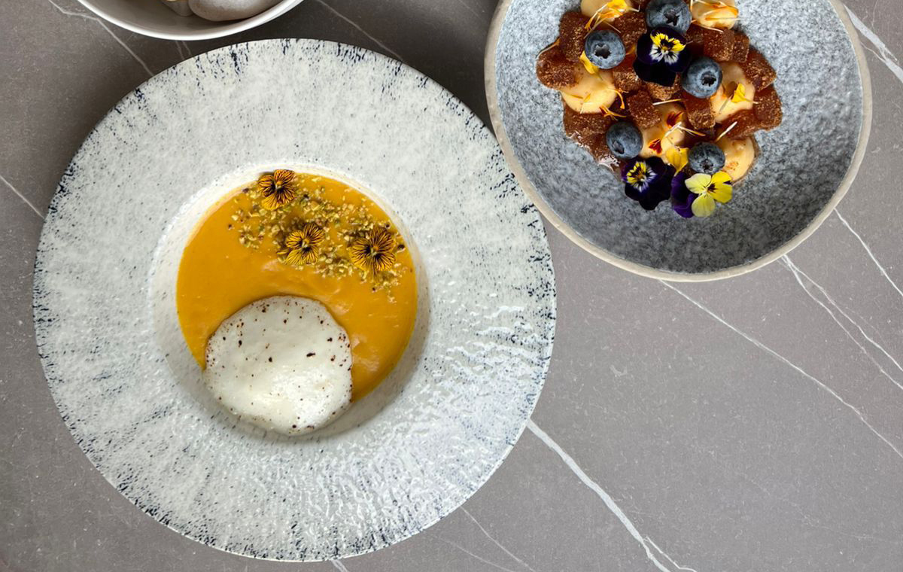

# Суп из репы с тыквой и голубым сыром

#### Ингредиенты

6 порций

* репа 250 г
* тыква 500 г
* чеснок 2 зубчика
* растительное масло 30 мл
* сахар 1 щепотка
* сушеный тимьян ½ ч. л.
* куриный бульон 600 мл
* сливки 15% 150 мл
* голубой сыр 80 г
* фисташки 3 ст. л.
* соль, молотый черный перец по вкусу

#### Приготовление

Очистить репу и тыкву от кожуры и нарезать их кубиками размером примерно 2–3 см.
Чеснок мелко порубить.

В кастрюле с толстым дном разогреть масло. Добавить чеснок и тимьян, готовить 1 минуту.Добавить нарезанные репу и тыкву. Обжаривать всё вместе 5–7 минут, помешивая. Посолить, поперчить и добавить сахар.

Залить овощи куриным бульоном. Довести до кипения, убавить огонь до среднего и варить под крышкой около 20–25 минут, пока репа и тыква не станут мягкими.

Снять кастрюлю с огня и измельчить суп погружным блендером в однородное пюре. Добавить сливки.

Голубой нарезать кубиками. Подавать, посыпав очищенными фисташками и украсив голубым сыром.

*Степан Лебедев, шеф ресторана «Байкал» в Сочи*