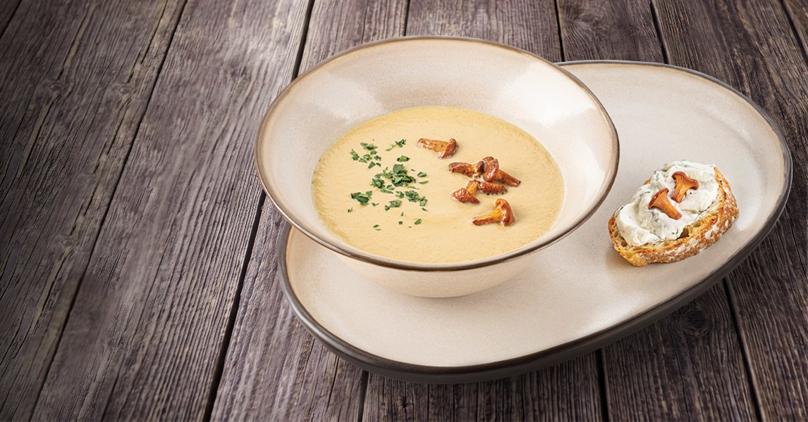

# Крем-суп из лисичек

#### Ингредиенты

6 порций

* лисички 480 г
* чеснок 3 зубчика
* растительное масло 15 мл
* куркума, тимьян
* белое сухое вино 10 мл
* грибной бульон 1,2 л
* картофель 120 г
* сливки 145 мл
* соль, молотый черный перец по вкусу

#### Приготовление

Лисички хорошо промыть. Чеснок мелко нарезать. Картофель очистить, нарезать тонкими слайсами.

В кастрюле с толстым дном разогреть растительное масло, обжарить чеснок на слабом огне до прозрачности, добавить куркуму и тимьян, перемешать. Влить белое вино и дать алкоголю выпариться в течение 1–2 минуты. Влить грибной бульон и довести до кипения.

Добавить картофель в бульон, варить до полной готовности картофеля. Засыпать обработанные лисички (оставив часть для украшения супа), варить ещё 5 минут. Снять кастрюлю с огня, перелить содержимое в чашу блендера и пробить до однородной консистенции.

Вернуть массу в чистый сотейник, добавить сливки, соль и свежемолотый чёрный перец, довести до кипения при постоянном помешивании.

Оставшиеся лисички обжарить и украсить ими суп при подаче.

*Анатолий Аношин, шеф-повар ресторана «Ян Примус»*