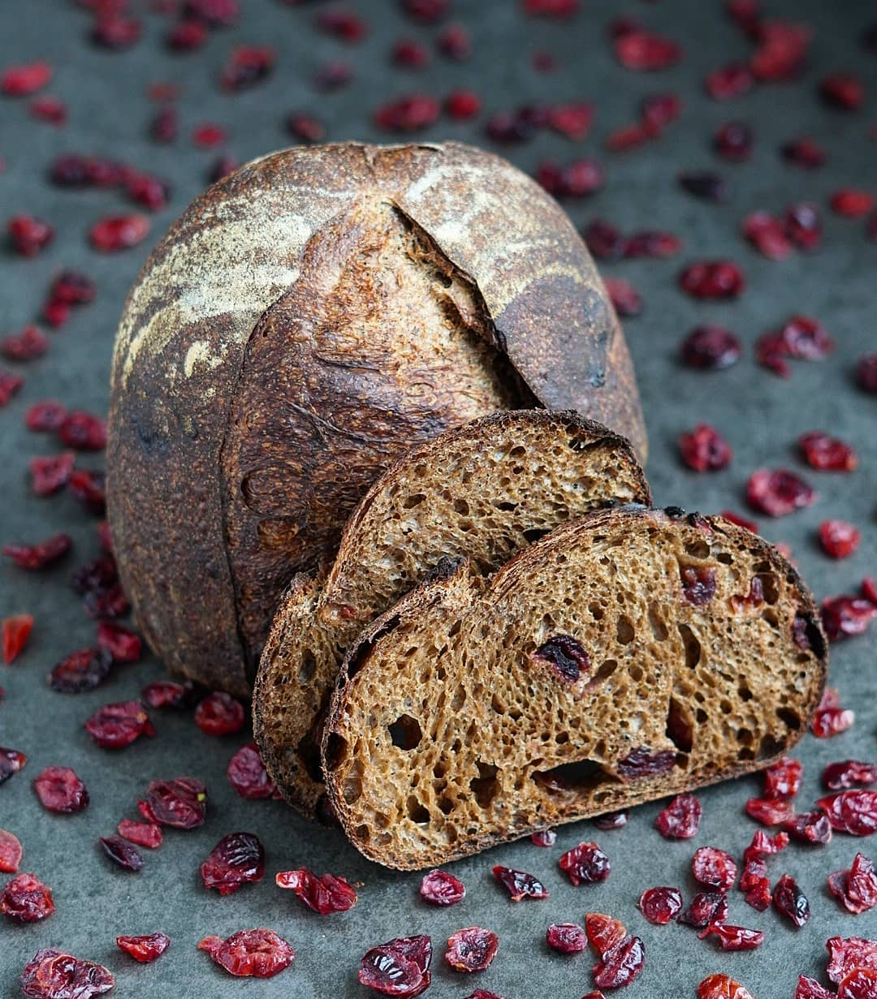

# Солодовый тартин с клюквой

#### Ингредиенты

**для заварки:**
* ржаная цз (или обдирная) мука 30 + 5 г
* ржаной ферментированный солод 40 г
* кипяток 140 мл

**для теста:**
* заварка вся
* вода1 220 мл
* пшеничная закваска 100% 110 г
* пшеничная мука в/с 430 г
* соль 12 г
* вода2 30 мл
* вяленая клюква 80 г

#### Приготовление

Соединить 30 г ржаной муки и солод в металлической или стеклянной посуде. Залить кипятком и перемешать. Добавить оставшиеся 5 г ржаной муки и ещё раз перемешать. Духовку прогреть до 100 °C и выключить. Миску накрыть фольгой и убрать в духовку на 2–3 часа (при температуре 64–66 °C) или оставить на 8–10 часов.

Размешать закваску с водой1 и заваркой, добавить пшеничную муку, месить тесто 1–2 минуты до однородности. Дать отдохнуть тесту 30–60 минут для автолиза.

Далее добавить соль, а через 5 минут замеса — воду2.

Замесить тесто методом складываний (либо в тестомесе 3–5 минут). Добавить клюкву.

Ёмкость с тестом накрыть и оставить для ферментации на 3–4 часа при температуре 24–26 °C. При этом через каждые 30 минут делать вытягивание и складывание (stretch & fold) — всего 4 раза.

Выбродившее тесто поделить пополам и округлить. Оставить на отлёжку на 10–15 минут, затем сформовать заготовки.

Оставить на расстойку на 30–40 минут при комнатной температуре, далее перенести в холодильник на 14–16 часов при 6–8 °C.

Перед выпечкой сделать неглубокий (до 1 см) надрез лезвием или хлебным ножом.

Выпекать в духовке, разогретой до 250 °C, первые 10 минут с паром, затем уменьшить температуру до 230 °C и выпекать ещё 10–15 минут. Готовый хлеб остудить на решётке.

*ig: zabavnikov_ivan*