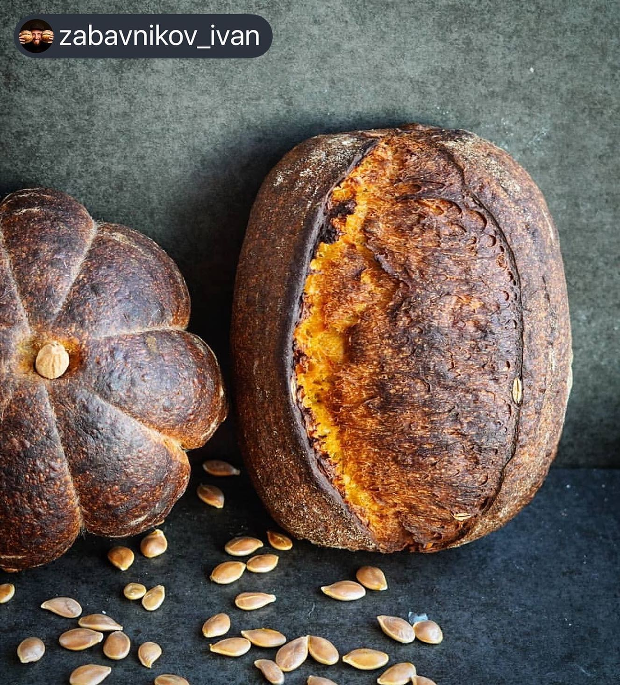

# Тыквенный тартин с семечками

#### Ингредиенты

* вода1 100 мл
* пюре из запечённой тыквы 100 г
* мука пшеничная хлеюная вс 280 г
* мука 00 120 г
* закваска (100% влажности) 80 г
* соль 8 г
* вода2 80 г
* вода3 50 г
* семечки (тыквенные, подсолнечные, лён и др.) 75 г
* куркума по вкусу

#### Приготовление

Тыкву почистить, нарезать на кусочки и запечь в духовке при 200С около 18-20 минут. Измельчить в блендере или в ступке.

Семечки обжарить в духовке, горячими залить 75 мл кипятка, перемешать, накрыть и оставить минимум на 1 час (лучше на ночь) в холодильнике. Затем отжатьи обсушить.
Соединить тыкву с вода1, добавить муку, месить тесто 1-2 минуты до однородности, накрыть и оставить на 20–30 минут (при необходимости переставить в холодильник на 20 минут перед замесом).

Добавить в тесто закваску и соль. Выровнять цвет куркумой. Замесить тесто методом складываний (либо в тестомесе 3/8 мин).
Вода2 через 5-6 минут замеса.  Вода3 если тесто плотное. Очень много зависит от самой тыквы. В конце замеса мягко вмешать отжатые семечки.

Оставить тесто на брожение на 3,5–4 часа при 24–25 °C. Сделать 3 складывания (stretch & fold) через каждые 30–40 минут.
Остановить брожение, когда тесто увеличится примерно на 50%.

Поставить миску с тестом в холодильник на 15–20 минут. Собрать в шар, дать отдохнуть 30-40 минут при комнатной температуре.

Сформовать батард или круглый хлеб, поместить в корзинки швом вверх (по желанию обвалять верх в подсушенных тыквенных семечках).

Оставить на холодную ферментацию на 10–12 часов при +4 °C под плёнкой или крышкой.

После холодильника сразу выпекать любым из вариантов: 1) Зафиксировать ниткой в форми тыквы, не слишком плотно. По желанию сделайть надрезы. 2)Перед посадкой в печь, сделать не глубокий (до 1 см) надрез лезвием или хлебным ножом.

Выпекать в духовке, разогретой до 240°C, первые 10 минут с паром, затем уменьшить температуру до 210°C и выпекать еще 15-20 минут. Чем слаще тыква, тем сильнее может подгореть хлеб.

Готовый хлеб остудить на решётке.

*Мария Селянина*
*ig: zabavnikov_ivan*