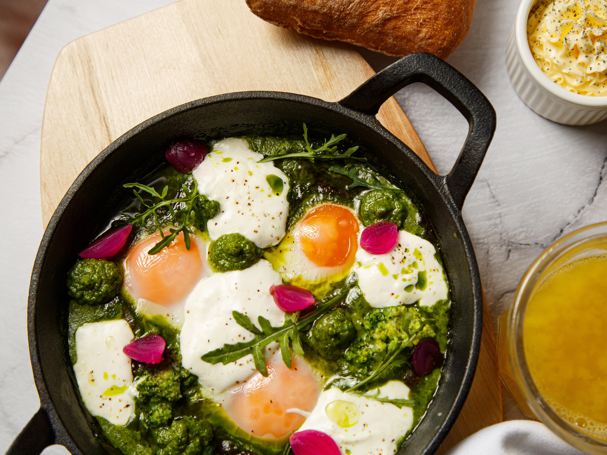

# Зеленая шакшука со шпинатом и сыром страчателла

#### Ингредиенты

* зеленые фисташки 30 г
* оливковое масло 30 мл
* рукола 100 г
* чеснок
* сахар
* сливки 15% 100 мл
* куриный бульон 130 мл
* шпинат 100 г
* картофельный крахмал 10 г
* капуста кейл 100 г
* куриное яйцо 4 шт.
* сыр страчателла 80 г
* соль, молотый черный перец по вкусу

#### Приготовление

Рукколу промыть, обсушить бумажными полотенцами. Шпинат промыть, удалить жесткие стебли.

Фисташки обжарить на сухой сковороде. Орехи, 20 мл оливкового масла, рукколу, чеснок поместить в чашу блендера и пробить до однородности. Добавить соль и сахар по вкусу.

Добавить 80 мл сливок и бульон, довести до кипения. Ввести шпинат, варить до мягкости.Пробить блендером, посолить и поперчить. При необходимости загустить крахмалом.

Кейл бланшировать. В чугунной сковороде соединить шпинатный соус и 20 мл сливок, довести до кипения. Добавить кейл. Сделать ложкой углубления и вбить яйца. Готовить под крышкой 5–7 минут на слабом огне.

Готовое блюдо украсить страчателлой и песто. Подавать горячим.

*Джеймс Редута, шеф-повар ресторана «Морекофеокеан by Erwin»*